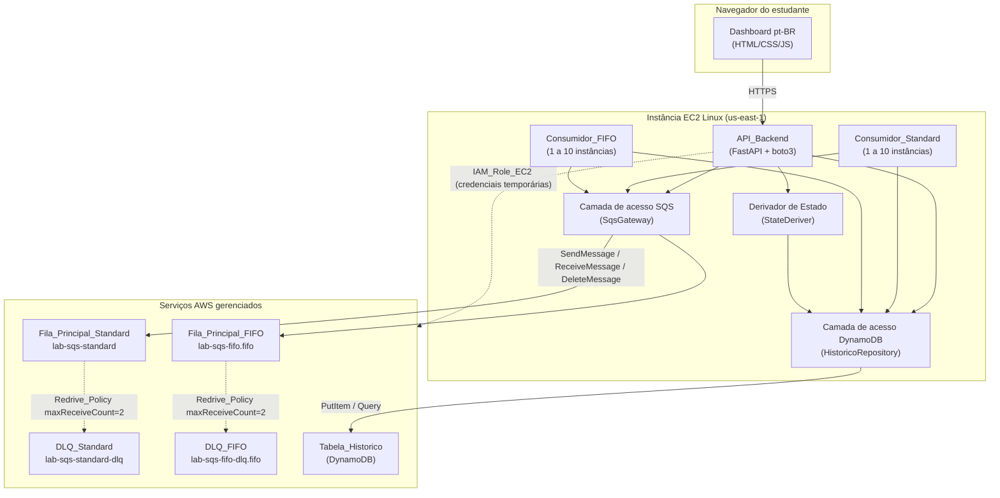
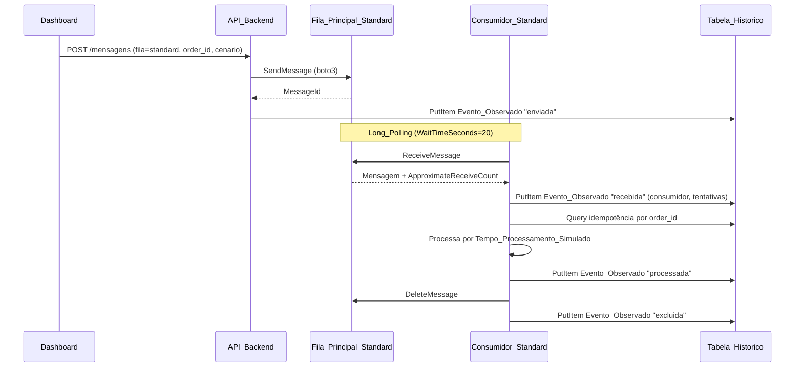
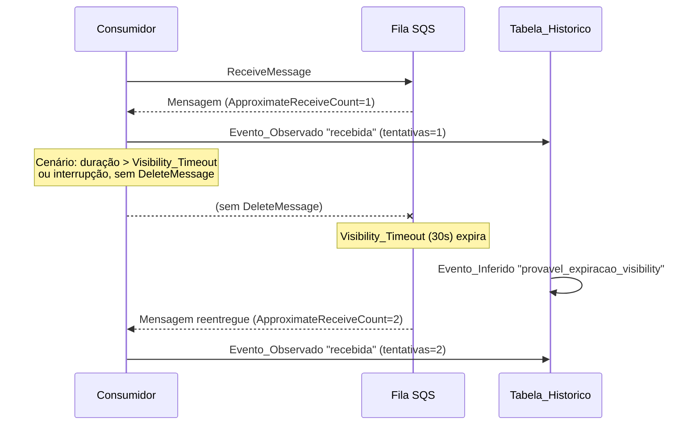
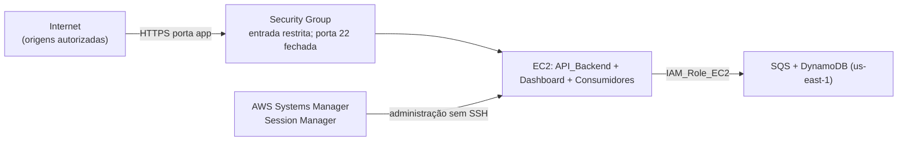
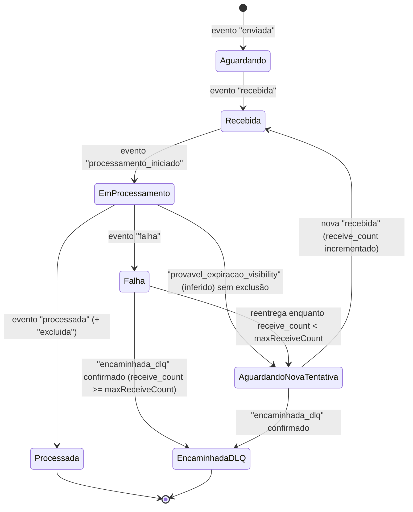

# Documento de Design

## Overview

Este documento descreve o design técnico do laboratório didático de **Amazon SQS** voltado ao estudo da certificação **AWS Solutions Architect Associate (SAA)**. A solução demonstra visualmente o ciclo de vida completo das mensagens SQS — envio, recebimento, processamento, falhas, reprocessamento e encaminhamento para **Dead-Letter Queue (DLQ)** — tanto no fluxo Standard quanto no fluxo FIFO.

A aplicação é executada integralmente em uma instância **Amazon EC2** Linux na região `us-east-1`, autenticando-se na AWS exclusivamente pela **IAM_Role_EC2** (credenciais temporárias, sem Access Keys fixas). O backend em Python expõe a **API_Backend** (`FastAPI`) e hospeda os processos **Consumidor_Standard** e **Consumidor_FIFO**, todos usando `boto3`. O **Dashboard** (HTML/CSS/JS) consome a API e apresenta as cinco áreas funcionais em pt-BR. O histórico, as tentativas e os eventos de cada mensagem são persistidos na **Tabela_Historico** (DynamoDB), porque o SQS **não** oferece API para consultar o estado individual de todas as mensagens.

### Decisões de design fundamentais

| Decisão | Rationale |
|---------|-----------|
| DynamoDB como fonte de verdade do estado observável | O SQS não expõe o estado individual das mensagens; é necessário um repositório de eventos para derivar o Estado e montar a linha do tempo (Req. 5.9, 5.10, 11). |
| Modelo baseado em eventos (event-log) com derivação do Estado | O Estado de cada mensagem (Aguardando, Recebida, ... , Encaminhada para DLQ) é **derivado** a partir dos eventos, não armazenado como campo mutável, evitando inconsistências e permitindo auditoria completa (Req. 5.9, 6). |
| Distinção explícita entre Evento_Observado e Evento_Inferido | O laboratório deve ser didaticamente honesto sobre o que foi confirmado pela AWS e o que foi deduzido pela aplicação (Req. 6.4, 6.5, 7.9, 11.9). |
| Idempotência por identificador de pedido (`order_id`) | Recebimentos repetidos (reentrega após Visibility_Timeout, filas Standard com entrega "at-least-once") não podem gerar efeitos colaterais duplicados (Req. 9). |
| Recursos AWS criados manualmente (sem IaC) | Objetivo didático: praticar criação e configuração no Console AWS. A aplicação apenas verifica e usa recursos existentes (Req. 1, 16). |
| Autenticação exclusiva via IAM Role da EC2 | Boa prática de segurança — nenhuma Access Key fixa em código, config ou variável de ambiente (Req. 12.1, 12.2). |

### Escopo e não-escopo

- **Escopo:** aplicação web (API + consumidores + Dashboard), modelagem do DynamoDB, lógica de derivação de estado, idempotência, concorrência, simulação de cenários de falha, segurança da aplicação e documentação.
- **Não-escopo (feito manualmente pelo usuário):** criação de filas, DLQs, tabela DynamoDB, IAM Role, EC2 e Security Groups. A aplicação **não** cria, modifica nem exclui recursos AWS (Req. 1.5, 1.7, 1.9).

## Architecture

### Visão geral da arquitetura



A autenticação de todos os componentes com a AWS ocorre pela **IAM_Role_EC2** anexada ao perfil da instância; o `boto3` resolve as credenciais temporárias automaticamente via metadata service (IMDSv2), sem Access Keys (Req. 12.1, 12.2).

### Fluxo Standard — caminho feliz



### Fluxo FIFO — ordenação por MessageGroupId

```mermaid
sequenceDiagram
    participant U as Dashboard
    participant API as API_Backend
    participant FIFO as Fila_Principal_FIFO
    participant C as Consumidor_FIFO
    participant DDB as Tabela_Historico

    U->>API: POST /mensagens (fila=fifo, order_id, MessageGroupId)
    API->>FIFO: SendMessage (MessageGroupId; dedup por conteúdo)
    FIFO-->>API: MessageId + SequenceNumber
    API->>DDB: PutItem Evento_Observado "enviada"
    loop Um MessageGroupId por instância por vez
        C->>FIFO: ReceiveMessage (Long_Polling 20s)
        FIFO-->>C: Mensagens do grupo em ordem
        C->>DDB: PutItem "recebida" (preserva ordem de recebimento)
        C->>C: Processa respeitando a ordem do grupo
        C->>DDB: PutItem "processada"
        C->>FIFO: DeleteMessage
    end
```

A fila FIFO entrega as mensagens de um mesmo `MessageGroupId` em ordem e só libera a próxima mensagem do grupo após a anterior ser excluída ou seu Visibility_Timeout expirar. O **Consumidor_FIFO** processa **um único MessageGroupId por instância por vez** (Req. 10.5, 10.6).

### Fluxo de falha e reentrega (expiração do Visibility_Timeout)



A reentrega é um **Evento_Observado** (novo ReceiveMessage com `ApproximateReceiveCount` incrementado). A expiração do Visibility_Timeout em si é um **Evento_Inferido**, pois o SQS não emite confirmação direta dela (Req. 6.5, 7.9).

### Fluxo de encaminhamento para DLQ

```mermaid
sequenceDiagram
    participant C as Consumidor
    participant SQS as Fila_Principal
    participant DLQ as DLQ
    participant DDB as Tabela_Historico

    C->>SQS: ReceiveMessage (ApproximateReceiveCount=1)
    C->>DDB: "recebida" tentativas=1
    Note over C,SQS: Processamento falha; sem DeleteMessage
    C->>SQS: ReceiveMessage (ApproximateReceiveCount=2)
    C->>DDB: "recebida" tentativas=2
    Note over SQS,DLQ: Recebimentos atingem maxReceiveCount (2)<br/>SQS move a mensagem para a DLQ
    SQS->>DLQ: Redrive automático
    C->>DLQ: ReceiveMessage detecta a mensagem na DLQ
    C->>DDB: Evento_Observado "encaminhada_dlq"
```

O Sistema **só** registra o encaminhamento para a DLQ como **Evento_Observado** quando a presença da mensagem na DLQ é confirmada (via ReceiveMessage na DLQ ou pela confirmação da Redrive_Policy), nunca apenas porque o Visibility_Timeout expirou (Req. 7.9, 7.10, 6.6).

### Topologia de rede e implantação



A arquitetura não usa **NAT Gateway** nem **Elastic Load Balancer** (salvo justificativa técnica documentada), e a administração da EC2 ocorre apenas via **Session_Manager**, com a porta 22 (SSH) sem regra de entrada liberada (Req. 15.1, 15.2, 15.3).

## Components and Interfaces

### API_Backend (FastAPI)

Serviço HTTP que expõe os endpoints consumidos pelo Dashboard e orquestra envio, leitura de estatísticas, monitoramento, histórico e controle dos consumidores. Responde em pt-BR e valida todas as entradas antes de agir.

Endpoints principais (contrato lógico):

| Método | Rota | Responsabilidade | Requisitos |
|--------|------|------------------|------------|
| `GET` | `/api/saude` | Verificação de inicialização: existência e acessibilidade dos recursos AWS | 1.6, 1.8 |
| `GET` | `/api/config` | Retorna Config_Aplicada e Config_Simulacao com rótulos distintos | 2.1–2.13 |
| `PUT` | `/api/config/simulacao` | Ajusta parâmetros de Config_Simulacao dentro das faixas | 2.8, 2.9, 2.11, 2.12 |
| `POST` | `/api/mensagens` | Envia 1 a 10 mensagens à fila selecionada | 4.1–4.12 |
| `GET` | `/api/estatisticas` | Estatísticas agregadas por fluxo (Standard/FIFO) | 3.1–3.12 |
| `GET` | `/api/monitoramento` | Tabela de monitoramento com Estado derivado | 5.1–5.10 |
| `GET` | `/api/mensagens/{order_id}/historico` | Linha do tempo cronológica de eventos | 6.1–6.8 |
| `POST` | `/api/laboratorio/cenario` | Executa cenário de falha controlado | 7.1–7.11 |
| `POST` | `/api/laboratorio/reprocessar-dlq` | Move mensagens da DLQ de volta à fila principal | 7.7 |
| `PUT` | `/api/consumidores/{tipo}/instancias` | Ajusta número de instâncias (1 a 10) | 10.1–10.3 |
| `POST` | `/api/autenticacao` | Login do Dashboard (usuário/senha) com bloqueio após 5 tentativas | 12.5, 12.6 |

Características transversais:
- Timeout de 3 s no percentil 95 sob 10 requisições simultâneas para `/api/estatisticas` e `/api/monitoramento`; ao exceder, retorna indicação de timeout e o Dashboard preserva os últimos dados válidos (Req. 14.1–14.4).
- Toda falha de autorização via IAM_Role_EC2 interrompe a operação, registra o evento e expõe erro sem persistir dados parciais (Req. 12.9).

### Consumidor_Standard

Processo (ou conjunto de 1 a 10 processos/threads) que recebe mensagens da **Fila_Principal_Standard** em lotes de 1 a 10, usando **Long_Polling** com `WaitTimeSeconds=20`. Para cada mensagem: registra o recebimento (Evento_Observado com consumidor e tentativas), verifica idempotência por `order_id`, aguarda o Tempo_Processamento_Simulado, aplica o Cenario_Falha e, em caso de sucesso, exclui a mensagem (DeleteMessage) e registra a exclusão (Req. 8, 14.5).

### Consumidor_FIFO

Semelhante ao Consumidor_Standard, porém opera sobre a **Fila_Principal_FIFO**, processa **um único MessageGroupId por instância por vez** e preserva a ordem de recebimento dentro do grupo (Req. 8, 10.5, 10.6, 14.6). O envio usa Deduplicacao_Por_Conteudo; quando desabilitada, aceita `MessageDeduplicationId` informado (Req. 4.6, 4.7).

### SqsGateway (camada de acesso ao SQS)

Encapsula o cliente `boto3` do SQS. Expõe operações `send_message`, `receive_messages`, `delete_message`, `get_queue_attributes` e `redrive_from_dlq`. Centraliza configuração de Long_Polling, leitura de `ApproximateReceiveCount` e tratamento uniforme de erros, sempre repassando o erro original da AWS (Req. 1.8, 4.12, 7.11, 8).

### HistoricoRepository (camada de acesso ao DynamoDB)

Encapsula o cliente `boto3` do DynamoDB sobre a **Tabela_Historico**. Expõe `registrar_evento` (PutItem com até 3 tentativas), `consultar_por_pedido`, `consultar_por_fila`, `listar_eventos_cronologico` e `contar_tentativas`. Retorna resultado vazio sem erro quando não há registros (Req. 11.1–11.9).

### StateDeriver (derivador de Estado)

Componente puro (sem efeitos colaterais) que recebe a lista de eventos de uma mensagem e retorna exatamente um Estado dentre: `Aguardando`, `Recebida`, `Em processamento`, `Processada`, `Falha`, `Aguardando nova tentativa`, `Encaminhada para DLQ`. É a base da coluna Estado do monitoramento e das estatísticas agregadas (Req. 5.4, 5.9).

### Dashboard

Aplicação web em pt-BR com cinco áreas: visão geral, envio, monitoramento, histórico detalhado e laboratório de falhas. Atualiza estatísticas e tabela de monitoramento periodicamente (intervalo configurável), exibe horário da última atualização bem-sucedida e preserva os últimos dados válidos em caso de falha (Req. 3, 5, 6, 7, 13). Quando exposto à internet, exige login e aplica bloqueio por origem após 5 tentativas inválidas (Req. 12.5, 12.6).

## Data Models

### Tabela_Historico (DynamoDB)

A **Tabela_Historico** é modelada como um **log de eventos append-only**: cada ação do ciclo de vida de uma mensagem gera um item de evento. O Estado nunca é armazenado como campo mutável — é **derivado** da sequência de eventos. Esse formato atende às três consultas exigidas (Req. 11.3, 11.4, 11.6, 16.2):

1. Consulta por **identificador de pedido** (`order_id`).
2. Consulta por **fila**.
3. **Listagem cronológica** de eventos de uma mensagem.

#### Chave primária e atributos

| Atributo | Papel | Tipo | Descrição |
|----------|-------|------|-----------|
| `PK` | Partition Key | String | `PEDIDO#<order_id>` — agrupa todos os eventos de um mesmo pedido. |
| `SK` | Sort Key | String | `EVENTO#<app_time_ms>#<seq>` — ordena eventos cronologicamente; `seq` é o desempate entre eventos de mesmo horário (Req. 6.1). |
| `order_id` | Atributo | String | Identificador do pedido (1–80 caracteres). |
| `queue_name` | Atributo (GSI PK) | String | Nome da fila: `lab-sqs-standard`, `lab-sqs-fifo.fifo` etc. |
| `event_type` | Atributo | String | Tipo do evento: `enviada`, `recebida`, `processamento_iniciado`, `processada`, `excluida`, `falha`, `recebimento_repetido`, `provavel_expiracao_visibility`, `aguardando_nova_tentativa`, `encaminhada_dlq`, `erro_validacao_order_id`, `erro_acesso_historico`. |
| `event_source` | Atributo | String | `OBSERVADO` ou `INFERIDO` (Req. 11.9). |
| `app_time` | Atributo | String | Horário real da aplicação em ISO-8601 UTC com milissegundos (Req. 8.3, 11.1). |
| `app_time_ms` | Atributo | Number | Epoch em milissegundos (usado na SK e na ordenação). |
| `consumer_id` | Atributo | String | Identificador único do consumidor responsável (Req. 8.4, 10.4). |
| `receive_count` | Atributo | Number | Contagem de recebimentos (`ApproximateReceiveCount`) ≥ 0 (Req. 5.2, 11.7). |
| `processing_seconds` | Atributo | Number | Tempo_Processamento_Simulado da mensagem (Req. 5.3). |
| `message_group_id` | Atributo | String | `MessageGroupId` (apenas FIFO) (Req. 10.6). |
| `sqs_message_id` | Atributo | String | `MessageId` retornado pelo SQS. |
| `error_detail` | Atributo | String | Erro original retornado pela AWS/aplicação, quando houver (Req. 4.12, 8.8, 11.2). |
| `GSI1PK` | GSI1 PK | String | `FILA#<queue_name>` — habilita consulta por fila. |
| `GSI1SK` | GSI1 SK | String | `<app_time_ms>#<order_id>` — ordena cronologicamente dentro da fila. |

#### Índices e padrões de acesso

| Padrão de acesso | Operação | Chaves | Requisito |
|------------------|----------|--------|-----------|
| Eventos de um pedido em ordem cronológica | `Query` na tabela base | `PK = PEDIDO#<order_id>`, `SK` crescente | 6.1, 11.3, 11.6 |
| Contagem de tentativas de um pedido | `Query` + agregação de `receive_count` | `PK = PEDIDO#<order_id>` | 5.2, 11.7 |
| Mensagens/eventos por fila | `Query` em `GSI1` | `GSI1PK = FILA#<queue_name>` | 11.4 |
| Monitoramento (todas as mensagens) + estatísticas | `Query` em `GSI1` por fila, agregando por `order_id` | `GSI1PK = FILA#<queue_name>` | 3, 5 |
| Mensagens em estado de falha | `Query` em `GSI1` + filtro de `event_type` de falha, derivação de Estado | `GSI1PK = FILA#<queue_name>` | 11.8 |

Observações:
- Modo de capacidade recomendado: **On-Demand (PAY_PER_REQUEST)** — adequado à carga variável de laboratório e sem gestão de throughput.
- Nenhuma consulta assume que o SQS fornece estado individual das mensagens; todo estado vem da Tabela_Historico (Req. 5.10).

#### Exemplos de itens de evento (JSON)

Evento de envio (Evento_Observado):

```json
{
  "PK": "PEDIDO#pedido-0001",
  "SK": "EVENTO#1719322800123#0001",
  "order_id": "pedido-0001",
  "queue_name": "lab-sqs-standard",
  "event_type": "enviada",
  "event_source": "OBSERVADO",
  "app_time": "2024-06-25T12:00:00.123Z",
  "app_time_ms": 1719322800123,
  "sqs_message_id": "a1b2c3d4-0001",
  "processing_seconds": 45,
  "GSI1PK": "FILA#lab-sqs-standard",
  "GSI1SK": "1719322800123#pedido-0001"
}
```

Evento de recebimento com contagem de tentativas (Evento_Observado):

```json
{
  "PK": "PEDIDO#pedido-0001",
  "SK": "EVENTO#1719322805456#0002",
  "order_id": "pedido-0001",
  "queue_name": "lab-sqs-standard",
  "event_type": "recebida",
  "event_source": "OBSERVADO",
  "app_time": "2024-06-25T12:00:05.456Z",
  "app_time_ms": 1719322805456,
  "consumer_id": "consumidor-standard-03",
  "receive_count": 1,
  "GSI1PK": "FILA#lab-sqs-standard",
  "GSI1SK": "1719322805456#pedido-0001"
}
```

Evento de provável expiração do Visibility_Timeout (Evento_Inferido):

```json
{
  "PK": "PEDIDO#pedido-0001",
  "SK": "EVENTO#1719322835460#0003",
  "order_id": "pedido-0001",
  "queue_name": "lab-sqs-standard",
  "event_type": "provavel_expiracao_visibility",
  "event_source": "INFERIDO",
  "app_time": "2024-06-25T12:00:35.460Z",
  "app_time_ms": 1719322835460,
  "receive_count": 1,
  "GSI1PK": "FILA#lab-sqs-standard",
  "GSI1SK": "1719322835460#pedido-0001"
}
```

Evento de encaminhamento para DLQ (Evento_Observado):

```json
{
  "PK": "PEDIDO#pedido-0001",
  "SK": "EVENTO#1719322900000#0007",
  "order_id": "pedido-0001",
  "queue_name": "lab-sqs-standard-dlq",
  "event_type": "encaminhada_dlq",
  "event_source": "OBSERVADO",
  "app_time": "2024-06-25T12:01:40.000Z",
  "app_time_ms": 1719322900000,
  "receive_count": 2,
  "GSI1PK": "FILA#lab-sqs-standard-dlq",
  "GSI1SK": "1719322900000#pedido-0001"
}
```

### Máquina de estados da mensagem

O Estado exibido no monitoramento é derivado dos eventos pelo **StateDeriver**. A transição segue o diagrama abaixo:



Estados (coluna Estado do monitoramento, Req. 5.4):

| Estado | Condição de derivação |
|--------|-----------------------|
| `Aguardando` | Há evento `enviada` e nenhum `recebida`. |
| `Recebida` | Último evento é `recebida` e ainda não iniciou processamento. |
| `Em processamento` | Há `processamento_iniciado` sem `processada`, `falha` nem reentrega posterior. |
| `Processada` | Há `processada` (e, idealmente, `excluida`); estado terminal de sucesso. |
| `Falha` | Último evento relevante é `falha` e `receive_count < maxReceiveCount`. |
| `Aguardando nova tentativa` | Houve `falha`/`provavel_expiracao_visibility` e a mensagem voltou a ficar visível, com `receive_count < maxReceiveCount`. |
| `Encaminhada para DLQ` | Há evento `encaminhada_dlq` confirmado (Evento_Observado); estado terminal. |

Regra de precedência: `Encaminhada para DLQ` e `Processada` são terminais. Nunca se deriva `Encaminhada para DLQ` apenas por expiração de Visibility_Timeout; exige confirmação da Redrive_Policy com `receive_count >= maxReceiveCount` (Req. 7.9, 7.10).

### Evento_Observado vs Evento_Inferido

| Classificação | Origem | Exemplos |
|---------------|--------|----------|
| **Evento_Observado** | Resposta direta de um serviço AWS ou ação concreta confirmada pela aplicação | `enviada` (retorno de SendMessage), `recebida` (retorno de ReceiveMessage), `excluida` (DeleteMessage confirmado), `encaminhada_dlq` (presença confirmada na DLQ) |
| **Evento_Inferido** | Dedução da aplicação a partir de condições indiretas, sem confirmação direta do SQS | `provavel_expiracao_visibility`, `aguardando_nova_tentativa` deduzido antes de nova entrega |

Cada evento carrega `event_source` (`OBSERVADO`/`INFERIDO`), e o Dashboard exibe um indicador textual distinto por evento sem exigir interação (Req. 6.4, 6.5, 11.9).

### Idempotência por identificador de pedido

Antes de executar os efeitos colaterais do processamento, o consumidor consulta a Tabela_Historico por `order_id`:

- Se já existe evento `processada` com sucesso para o `order_id`, o consumidor **não** reexecuta os efeitos colaterais e registra `recebimento_repetido` (Evento_Observado) com `order_id` e instante da detecção (Req. 9.1, 9.4, 9.6).
- Se a mensagem não contém `order_id` ou ele é inválido, o consumidor rejeita o processamento, registra `erro_validacao_order_id` (Evento_Observado) e preserva a mensagem para reprocessamento (Req. 9.3).
- Se a leitura/escrita na Tabela_Historico falhar durante a verificação, o consumidor **não** executa efeitos colaterais, preserva a mensagem e registra `erro_acesso_historico` (Evento_Observado) (Req. 9.5).

O resultado é exatamente **um** processamento concluído por `order_id`, independentemente do número de recebimentos (Req. 9.6).

### Gestão de consumidores concorrentes e ordenação FIFO

- O número de instâncias de cada tipo de consumidor é ajustável de **1 a 10** e aplicado em até 5 s; valores fora da faixa são rejeitados preservando o número anterior (Req. 10.1–10.3).
- Cada recebimento registra o `consumer_id` único e o instante (Req. 10.4).
- No FIFO, cada instância processa **um único `MessageGroupId` por vez** e preserva a ordem de recebimento dentro do grupo (Req. 10.5, 10.6). O SQS FIFO garante que mensagens de um mesmo grupo não são entregues a outro consumidor até exclusão ou expiração, o que, combinado ao processamento single-group por instância, mantém a ordem.
- A comparação por grupos exibe a sequência de processamento por `MessageGroupId` e o consumidor responsável por cada mensagem (Req. 10.7).

## Correctness Properties

*Uma propriedade é uma característica ou comportamento que deve ser verdadeiro em todas as execuções válidas de um sistema — essencialmente, uma afirmação formal sobre o que o sistema deve fazer. As propriedades servem de ponte entre especificações legíveis por humanos e garantias de correção verificáveis por máquina.*

As propriedades abaixo derivam dos critérios de aceitação testáveis identificados no prework. Elas incidem sobre a **lógica da aplicação** (derivação de Estado, idempotência, ordenação, validação, classificação de eventos, round-trip de registro/consulta), onde o comportamento varia significativamente com a entrada. Critérios de infraestrutura (SSE-SQS, verificação de recursos AWS, desempenho p95, autenticação via IAM Role) são validados por testes de integração/smoke descritos na estratégia de testes.

### Property 1: Validação de faixa aceita se e só se dentro dos limites

*Para qualquer* parâmetro de faixa `[min, max]`, qualquer valor anterior válido e qualquer valor informado, a validação deve aceitar o valor se e somente se `min <= valor <= max`; quando rejeita, o valor anterior deve permanecer inalterado.

**Validates: Requirements 2.12, 10.3, 13.3**

### Property 2: Estatísticas derivadas são inteiros não-negativos

*Para qualquer* log de eventos da Tabela_Historico, cada estatística agregada (enviadas, disponíveis, em processamento, processadas, com falha, encaminhadas para DLQ, recebidas por consumidor) e a contagem de tentativas de cada mensagem devem ser inteiros maiores ou iguais a 0.

**Validates: Requirements 3.1, 3.2, 3.3, 3.4, 3.5, 3.6, 3.7, 3.12, 5.2, 11.7**

### Property 3: Estatísticas particionam corretamente por fluxo

*Para qualquer* log de eventos contendo eventos das filas Standard e FIFO, a soma de cada contador do fluxo Standard com o contador correspondente do fluxo FIFO deve igualar o contador total daquele tipo, sem contabilizar um evento de uma fila no fluxo da outra.

**Validates: Requirements 3.8**

### Property 4: Estado derivado é único e pertence ao conjunto permitido

*Para qualquer* sequência de eventos válida de uma mensagem, o StateDeriver deve retornar exatamente um Estado pertencente ao conjunto {Aguardando, Recebida, Em processamento, Processada, Falha, Aguardando nova tentativa, Encaminhada para DLQ}.

**Validates: Requirements 5.4, 5.9**

### Property 5: DLQ nunca é inferida apenas por expiração do Visibility_Timeout

*Para qualquer* log de eventos que contenha expiração do Visibility_Timeout mas não contenha um evento `encaminhada_dlq` confirmado (Evento_Observado) com `receive_count >= maxReceiveCount`, o Estado derivado nunca deve ser "Encaminhada para DLQ".

**Validates: Requirements 7.9, 7.10, 6.6**

### Property 6: Eventos são listados em ordem cronológica crescente com desempate estável

*Para qualquer* conjunto de eventos de uma mensagem, a listagem resultante deve ser monotonicamente não-decrescente por `app_time_ms` e, entre eventos de mesmo horário, deve respeitar a ordem de registro (`seq`) como desempate estável.

**Validates: Requirements 6.1, 11.6**

### Property 7: Classificação de origem de cada evento é válida e consistente

*Para qualquer* evento registrado, `event_source` deve ser exatamente OBSERVADO ou INFERIDO; todo evento de provável expiração do Visibility_Timeout deve ser INFERIDO e todo evento de encaminhamento confirmado para a DLQ deve ser OBSERVADO.

**Validates: Requirements 6.4, 6.5, 11.9**

### Property 8: Validação de envio aceita se e só se todos os campos são válidos

*Para qualquer* payload de envio, a validação deve aceitar se e somente se a quantidade estiver em [1,10], o `order_id` tiver de 1 a 80 caracteres, o Tempo_Processamento_Simulado estiver em [0,300] e, para FIFO, o `MessageGroupId` tiver de 1 a 128 caracteres; ao rejeitar, deve identificar ao menos um campo inválido e preservar os valores informados.

**Validates: Requirements 4.9**

### Property 9: Envio bem-sucedido registra exatamente um Evento_Observado "enviada" por mensagem

*Para qualquer* lote de mensagens cujo envio ao SQS tenha sucesso, o número de eventos `enviada` OBSERVADO registrados na Tabela_Historico deve ser igual ao número de mensagens enviadas, cada um associado ao `order_id` correspondente.

**Validates: Requirements 4.11**

### Property 10: Falha parcial de envio preserva envios anteriores e o erro original

*Para qualquer* lote em que o envio falhe na posição `k`, todas as mensagens enviadas com sucesso nas posições anteriores a `k` devem permanecer registradas como `enviada` e o erro original retornado pela AWS deve ser preservado no registro de falha.

**Validates: Requirements 4.12**

### Property 11: Processamento é idempotente por identificador de pedido

*Para qualquer* `order_id` e qualquer número de recebimentos N (N >= 1) da mesma mensagem, os efeitos colaterais do processamento devem ser executados exatamente uma vez; recebimentos adicionais após um processamento concluído com sucesso devem gerar um Evento_Observado `recebimento_repetido` sem reexecutar efeitos colaterais.

**Validates: Requirements 9.1, 9.4, 9.6**

### Property 12: Identificador de pedido inválido rejeita o processamento

*Para qualquer* mensagem cujo `order_id` esteja ausente ou inválido (vazio, nulo ou com mais de 80 caracteres), o consumidor deve rejeitar o processamento, registrar um Evento_Observado `erro_validacao_order_id` e preservar a mensagem para reprocessamento.

**Validates: Requirements 9.3**

### Property 13: Mensagem é excluída se e só se o processamento concluir com sucesso

*Para qualquer* resultado de processamento sob um Cenario_Falha arbitrário, a operação DeleteMessage deve ser executada se e somente se o processamento concluiu com sucesso; em qualquer outro desfecho a mensagem é preservada na fila.

**Validates: Requirements 8.6, 8.7, 8.9**

### Property 14: Ordenação FIFO é preservada dentro de cada MessageGroupId

*Para qualquer* sequência de mensagens de um mesmo `MessageGroupId`, processada por uma instância de Consumidor_FIFO que trata um único grupo por vez, a ordem de processamento deve ser igual à ordem de recebimento das mensagens do grupo.

**Validates: Requirements 10.5, 10.6**

### Property 15: Round-trip de registro e consulta preserva e filtra os eventos

*Para qualquer* conjunto de eventos registrados, consultar por `order_id` deve retornar exatamente os eventos daquele pedido, consultar por fila deve retornar exatamente os eventos daquela fila, e ambas as consultas sem correspondência devem retornar resultado vazio sem erro.

**Validates: Requirements 11.3, 11.4, 11.5**

### Property 16: Escrita de evento tenta no máximo 3 vezes e preserva a mensagem no esgotamento

*Para qualquer* padrão de falhas transitórias de escrita na Tabela_Historico, se ocorrerem até 3 falhas seguidas de sucesso a escrita deve concluir; se as 3 tentativas falharem, a mensagem original deve ser preservada e o erro sinalizado, sem exceder 3 tentativas.

**Validates: Requirements 11.2**

### Property 17: Bloqueio de autenticação ativa após 5 falhas consecutivas

*Para qualquer* sequência de tentativas de autenticação de uma mesma origem, o acesso deve ser bloqueado assim que ocorrerem 5 falhas consecutivas, permanecer bloqueado por 300 segundos e um sucesso antes do limite deve reiniciar a contagem de falhas consecutivas.

**Validates: Requirements 12.6**

## Error Handling

A estratégia de tratamento de erros preserva a honestidade didática (nunca inventar estado), nunca modifica recursos AWS e sempre comunica em pt-BR.

| Situação | Tratamento | Requisitos |
|----------|------------|------------|
| Recurso AWS ausente/inacessível na inicialização | Registrar o erro original da AWS, interromper a inicialização sem alterar recursos e exibir no Dashboard o recurso indisponível por nome e tipo | 1.6, 1.8 |
| Valor de Config_Simulacao fora da faixa | Rejeitar, preservar valor anterior, exibir faixa válida em pt-BR | 2.12 |
| Tentativa de alterar Config_Aplicada | Orientar que a alteração deve ser feita manualmente no Console AWS | 2.13 |
| Campo de envio inválido | Rejeitar o envio, preservar valores informados, indicar o campo inválido | 4.9 |
| Falha no envio de uma mensagem do lote | Preservar mensagens já enviadas, registrar o erro original, exibir falha de envio | 4.12 |
| Falha ao atualizar estatísticas/monitoramento | Preservar últimos valores válidos, manter horário da última atualização bem-sucedida, exibir indicação de falha | 3.11, 13.5 |
| Consulta de histórico sem eventos ou com falha | Preservar a tela/tabela anterior, exibir mensagem de histórico indisponível/ausência de eventos | 5.7, 6.7, 6.8 |
| Erro de processamento no consumidor | Preservar a mensagem para reprocessamento, registrar o erro original na Tabela_Historico | 8.8 |
| `order_id` ausente/inválido | Rejeitar processamento, registrar `erro_validacao_order_id`, preservar mensagem | 9.3 |
| Falha de acesso à Tabela_Historico na verificação de idempotência | Não executar efeitos colaterais, preservar mensagem, registrar `erro_acesso_historico` | 9.5 |
| Falha de escrita de evento | Repetir até 3 vezes; persistindo, preservar a mensagem e sinalizar o erro | 11.2 |
| Instâncias de consumidor fora de 1–10 | Rejeitar, preservar número anterior, indicar intervalo válido | 10.3 |
| Fila indisponível/autenticação falha durante cenário | Interromper o cenário, exibir a causa em pt-BR | 7.11 |
| Falha de autorização via IAM_Role_EC2 | Interromper a operação afetada, registrar a falha, expor erro de autorização sem persistir dados parciais | 12.9 |
| Timeout de estatísticas/monitoramento (>3 s) | Retornar indicação de timeout; Dashboard preserva últimos dados válidos | 14.3, 14.4 |

Princípios gerais:
- Erros originais da AWS são sempre preservados e registrados (nunca mascarados).
- Nenhum tratamento de erro cria, modifica ou exclui recursos AWS (Req. 1.7).
- Falhas de leitura/escrita no histórico levam o consumidor a preservar a mensagem para reprocessamento, nunca a excluí-la prematuramente (Req. 8.7).

## Testing Strategy

A estratégia combina **testes unitários** (exemplos e casos de borda), **testes baseados em propriedades** (propriedades universais sobre a lógica da aplicação) e **testes de integração/smoke** (comportamento de infraestrutura e serviços AWS).

### Testes baseados em propriedades (PBT)

- Biblioteca: **Hypothesis** (padrão para Python), não implementando PBT do zero.
- Cada propriedade de correção é implementada por **um único** teste baseado em propriedades.
- Mínimo de **100 iterações** por teste de propriedade (`@settings(max_examples=100)` ou superior).
- Cada teste é anotado com um comentário referenciando a propriedade do design, no formato:
  `# Feature: aws-sqs-lab, Property {número}: {texto da propriedade}`
- Dependências externas (SQS, DynamoDB) são substituídas por **mocks/fakes em memória** nos testes de propriedade, isolando a lógica (StateDeriver, idempotência, ordenação FIFO, validações, classificação de eventos, round-trip de registro/consulta, retry de escrita, bloqueio de autenticação).

Mapeamento propriedade → alvo:

| Propriedade | Alvo principal | Mocks |
|-------------|----------------|-------|
| 1 | Validação de faixa (Config_Simulacao, instâncias, intervalo) | — |
| 2, 3 | Agregador de estatísticas (StateDeriver + contadores) | fake de eventos |
| 4, 5 | StateDeriver | fake de eventos |
| 6 | Ordenação cronológica da listagem | — |
| 7 | Classificador de origem de evento | — |
| 8 | Validação de envio | — |
| 9, 10 | Fluxo de envio da API_Backend | mock SQS + fake DynamoDB |
| 11, 12 | Verificação de idempotência do consumidor | fake DynamoDB |
| 13 | Lógica de exclusão do consumidor | mock SQS |
| 14 | Processamento FIFO single-group | fake de fila |
| 15 | HistoricoRepository (round-trip) | fake DynamoDB em memória |
| 16 | registrar_evento (retry) | mock DynamoDB com falhas programadas |
| 17 | Controle de bloqueio de autenticação | relógio simulado |

### Testes unitários (exemplos e bordas)

- Casos concretos de derivação de Estado para cada estado terminal e intermediário.
- Bordas das faixas (0, 1, 10, 300, 128 caracteres) nas validações.
- Caso de log vazio produzindo estatísticas 0 (Req. 3.12).
- Consultas sem correspondência retornando vazio (Req. 11.5).
- Mensagens de erro em pt-BR nas rejeições.

### Testes de integração (serviços AWS, 1–3 exemplos)

- Verificação de inicialização contra recursos presentes e ausentes (Req. 1.6, 1.8).
- Confirmação de SSE-SQS habilitado via `get_queue_attributes` (Req. 12.8).
- Fluxo ponta a ponta Standard: envio → recebimento → exclusão sem erro (Req. 18.1).
- Reentrega após expiração do Visibility_Timeout (Req. 18.2) e encaminhamento para DLQ ao atingir `maxReceiveCount` (Req. 18.3).
- Ordenação FIFO ponta a ponta com ao menos 3 mensagens no mesmo grupo (Req. 18.4).
- Concorrência com ao menos 2 consumidores sem processamento duplicado dentro do Visibility_Timeout (Req. 18.5).
- Recuperação: mensagem reaparece após consumidor encerrar sem excluir (Req. 18.6).

### Testes de smoke e verificação estática

- Ausência de `aws_access_key_id`/`aws_secret_access_key` em código, configuração e variáveis de ambiente (Req. 12.2).
- Autenticação via IAM_Role_EC2 bem-sucedida contra SQS e DynamoDB (Req. 12.1, 12.3).
- Revisão da policy IAM confirmando privilégios mínimos (Req. 12.3).

### Testes de desempenho (carga)

- `/api/estatisticas` e `/api/monitoramento` sob 10 requisições simultâneas, verificando p95 ≤ 3 s (Req. 14.1, 14.2).

### Rastreabilidade

Cada teste referencia o requisito ou a propriedade que valida. As propriedades 1–17 cobrem os critérios de aceitação testáveis como propriedades; os demais critérios são cobertos pelos testes de integração, smoke e desempenho listados acima, garantindo cobertura completa dos 18 requisitos.
