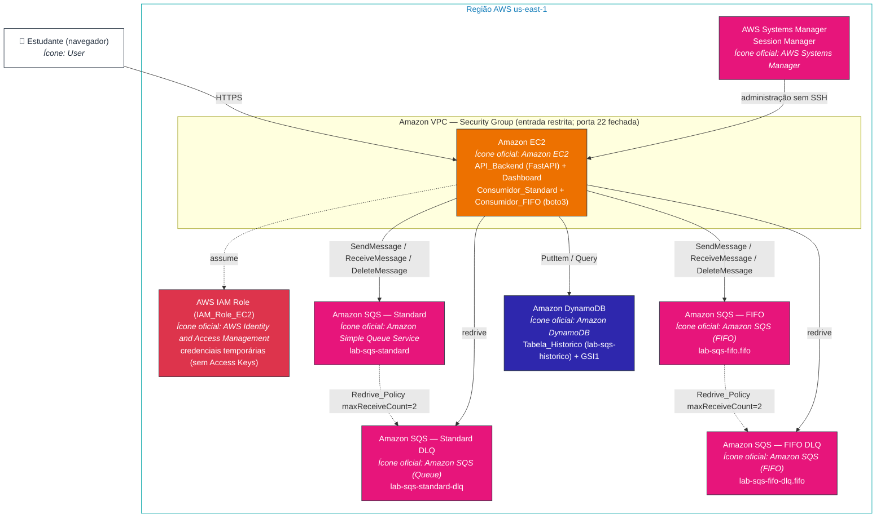
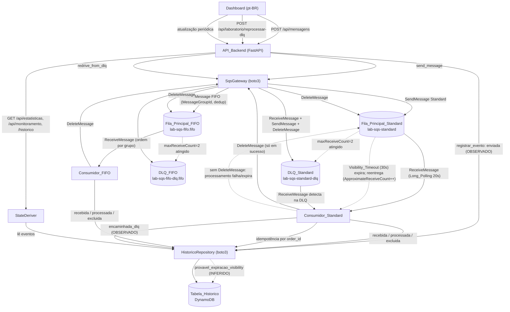

# Arquitetura — Laboratório Amazon SQS

> Documento de arquitetura do laboratório didático de **Amazon SQS** voltado ao estudo da certificação **AWS Solutions Architect Associate (SAA)**. Descreve apenas o que existe de fato no projeto (código em `app/` e `web/`) e os recursos AWS que a aplicação **usa** — ela nunca cria, modifica nem exclui recursos AWS.

## Sumário

- [Visão geral da solução](#visão-geral-da-solução)
- [Serviços AWS utilizados](#serviços-aws-utilizados)
- [Diagrama de arquitetura (ícones oficiais AWS)](#diagrama-de-arquitetura-ícones-oficiais-aws)
- [Diagrama único de todos os fluxos (Mermaid)](#diagrama-único-de-todos-os-fluxos-mermaid)
- [Fluxos detalhados](#fluxos-detalhados)
  - [Fluxo Standard](#fluxo-standard)
  - [Fluxo FIFO](#fluxo-fifo)
  - [Fluxo de falha e reentrega](#fluxo-de-falha-e-reentrega-expiração-do-visibility_timeout)
  - [Fluxo de encaminhamento para a DLQ](#fluxo-de-encaminhamento-para-a-dlq)
- [Integração com o DynamoDB](#integração-com-o-dynamodb)
- [Integração com o Dashboard](#integração-com-o-dashboard)
- [Permissões IAM (mínimo privilégio)](#permissões-iam-mínimo-privilégio)

## Visão geral da solução

A solução é uma aplicação web em português do Brasil (pt-BR) que demonstra, de forma visual, o ciclo de vida completo das mensagens do **Amazon SQS** — envio, recebimento, processamento, falhas, reentrega e encaminhamento para a **Dead-Letter Queue (DLQ)** — tanto no fluxo **Standard** quanto no fluxo **FIFO**.

Toda a aplicação é executada em uma instância **Amazon EC2** Linux na região `us-east-1`. O backend em **Python** usa `FastAPI` e `boto3`: a **API_Backend** (`app/api/app.py`) expõe os endpoints consumidos pelo Dashboard e hospeda os processos **Consumidor_Standard** (`app/consumidores/consumidor_standard.py`) e **Consumidor_FIFO** (`app/consumidores/consumidor_fifo.py`). O **Dashboard** (`web/`, HTML/CSS/JS) consome a API e apresenta cinco áreas funcionais em pt-BR.

A autenticação com a AWS ocorre **exclusivamente** pela **IAM_Role_EC2** anexada ao perfil da instância: o `boto3` resolve credenciais temporárias pela cadeia de provedores padrão (via metadata service da EC2), sem nenhuma Access Key fixa em código, configuração ou variável de ambiente. Isso é confirmado no código das camadas de acesso, que criam os clientes `boto3` sem `aws_access_key_id`/`aws_secret_access_key`.

Como o SQS **não** oferece API para consultar o estado individual de todas as mensagens, o estado observável é derivado de um **log de eventos** persistido na **Tabela_Historico** (DynamoDB). Cada ação do ciclo de vida gera um item de evento; o Estado de cada mensagem (Aguardando, Recebida, Em processamento, Processada, Falha, Aguardando nova tentativa, Encaminhada para DLQ) é **derivado** desses eventos pelo componente `StateDeriver` (`app/dominio/state_deriver.py`), nunca armazenado como campo mutável.

Decisões de arquitetura relevantes:

| Decisão | Motivação |
|---------|-----------|
| DynamoDB como fonte de verdade do estado observável | O SQS não expõe o estado individual das mensagens; é preciso um repositório de eventos para derivar o Estado e montar a linha do tempo. |
| Modelo baseado em eventos (event-log) e derivação do Estado | Evita inconsistências e permite auditoria completa do ciclo de vida. |
| Distinção explícita entre `Evento_Observado` e `Evento_Inferido` | Honestidade didática: separar o que a AWS confirmou do que a aplicação deduziu. |
| Idempotência por `order_id` | Entrega *at-least-once* do Standard e reentregas após Visibility_Timeout não podem gerar efeitos duplicados. |
| Recursos AWS criados manualmente (sem IaC) | Objetivo didático de praticar a criação e configuração no Console AWS. |
| Autenticação exclusiva via IAM_Role_EC2 | Boa prática de segurança — sem Access Keys fixas. |
| Sem NAT Gateway e sem Elastic Load Balancer; administração via Session Manager | Controle de custo e redução da superfície de ataque (porta 22/SSH sem regra de entrada). |

## Serviços AWS utilizados

| Serviço AWS | Recurso no laboratório | Função |
|-------------|------------------------|--------|
| **Amazon SQS (Standard)** | `lab-sqs-standard` (Fila_Principal_Standard) | Fila principal do fluxo Standard; recebe os envios e entrega as mensagens ao Consumidor_Standard com entrega *at-least-once* e sem garantia de ordem. |
| **Amazon SQS (Standard — DLQ)** | `lab-sqs-standard-dlq` (DLQ_Standard) | Dead-Letter Queue do fluxo Standard; recebe mensagens que atingem `maxReceiveCount` (2) na Redrive_Policy. |
| **Amazon SQS (FIFO)** | `lab-sqs-fifo.fifo` (Fila_Principal_FIFO) | Fila principal do fluxo FIFO; garante ordem por `MessageGroupId` e deduplicação (por conteúdo ou por `MessageDeduplicationId`). |
| **Amazon SQS (FIFO — DLQ)** | `lab-sqs-fifo-dlq.fifo` (DLQ_FIFO) | Dead-Letter Queue do fluxo FIFO; recebe mensagens que atingem `maxReceiveCount` (2), preservando o agrupamento FIFO. |
| **Amazon DynamoDB** | `lab-sqs-historico` (Tabela_Historico) | Log de eventos append-only do ciclo de vida das mensagens; fonte de verdade para estatísticas, monitoramento e linha do tempo. |
| **Amazon EC2** | Instância Linux (us-east-1) | Hospeda a API_Backend, os consumidores e serve o Dashboard. |
| **AWS IAM (IAM Role)** | IAM_Role_EC2 | Fornece credenciais temporárias de mínimo privilégio para a aplicação acessar SQS e DynamoDB, sem Access Keys fixas. |
| **AWS Systems Manager — Session Manager** | Session_Manager | Acesso administrativo à EC2 sem abrir a porta 22 (SSH) no Security Group. |
| **SSE-SQS** | Criptografia em repouso das filas | Protege as mensagens armazenadas nas filas SQS (verificável via `get_queue_attributes`). |

> Parâmetros de Config_Aplicada fixados nos recursos SQS (definidos em `app/dominio/constantes.py`): `Visibility_Timeout` = 30 s, `maxReceiveCount` = 2, `Long_Polling (WaitTimeSeconds)` = 20 s, retenção de 4 dias nas filas principais e 14 dias nas DLQs, SSE-SQS habilitado e deduplicação por conteúdo habilitada nas filas FIFO.

## Diagrama de arquitetura (ícones oficiais AWS)

O diagrama abaixo representa a arquitetura da solução usando a convenção visual dos **AWS Architecture Icons** oficiais. Cada caixa referencia o ícone oficial do serviço correspondente (nome do ícone no catálogo [AWS Architecture Icons](https://aws.amazon.com/architecture/icons/)). As classes de cor seguem a paleta oficial por categoria de serviço (laranja para App Integration/Compute, azul para Database, vermelho para Security).



## Diagrama único de todos os fluxos (Mermaid)

O diagrama a seguir cobre, em um único grafo, **todos** os fluxos do laboratório: envio (Standard e FIFO), recebimento e processamento, caminho feliz (exclusão), falha com reentrega por expiração do Visibility_Timeout, encaminhamento para a DLQ e reprocessamento (redrive). As linhas tracejadas representam movimentações automáticas do SQS; as pontilhadas representam eventos inferidos pela aplicação.



## Fluxos detalhados

### Fluxo Standard

1. O Dashboard chama `POST /api/mensagens`; a API valida o payload e envia de 1 a 10 mensagens via `SqsGateway.send_message` para `lab-sqs-standard`.
2. Para cada envio bem-sucedido, a API registra um `Evento_Observado` `enviada` na Tabela_Historico.
3. O **Consumidor_Standard** recebe mensagens em lotes de 1 a 10 com **Long_Polling** (`WaitTimeSeconds=20`), lê `ApproximateReceiveCount` e registra `recebida` (com `consumer_id` e tentativas).
4. Verifica idempotência por `order_id` na Tabela_Historico; se já houver `processada`, registra `recebimento_repetido` e não reexecuta efeitos.
5. Processa pelo `Tempo_Processamento_Simulado`, registra `processada` e, **somente em caso de sucesso**, executa `DeleteMessage` e registra `excluida`.

### Fluxo FIFO

1. O envio informa `MessageGroupId` e usa deduplicação por conteúdo; quando desabilitada, aceita `MessageDeduplicationId` informado.
2. O **Consumidor_FIFO** recebe em lotes com Long_Polling (`WaitTimeSeconds=20`) e processa **um único `MessageGroupId` por instância por vez**, preservando a ordem de recebimento dentro do grupo.
3. O SQS FIFO não libera a próxima mensagem do grupo até que a anterior seja excluída ou seu Visibility_Timeout expire — o que, combinado ao processamento single-group por instância, mantém a ordem.
4. O registro de eventos e a idempotência seguem o mesmo padrão do fluxo Standard.

### Fluxo de falha e reentrega (expiração do Visibility_Timeout)

1. O consumidor recebe a mensagem (`ApproximateReceiveCount=1`) e registra `recebida` (tentativas=1).
2. Sob um cenário de falha (duração maior que o Visibility_Timeout ou interrupção), **não** há `DeleteMessage`.
3. Após expirar o `Visibility_Timeout` (30 s), a mensagem volta a ficar visível e é reentregue com `ApproximateReceiveCount=2`.
4. A reentrega é um `Evento_Observado` (novo `ReceiveMessage`). A expiração em si é registrada como `provavel_expiracao_visibility` (`Evento_Inferido`), pois o SQS não emite confirmação direta dela.

### Fluxo de encaminhamento para a DLQ

1. Após as tentativas atingirem o `maxReceiveCount` da Redrive_Policy (2), o **SQS** move automaticamente a mensagem para a DLQ correspondente (`lab-sqs-standard-dlq` ou `lab-sqs-fifo-dlq.fifo`).
2. O Sistema **só** registra `encaminhada_dlq` como `Evento_Observado` quando a presença da mensagem na DLQ é confirmada (via `ReceiveMessage` na DLQ ou pela Redrive_Policy). Nunca deriva "Encaminhada para DLQ" apenas por expiração de Visibility_Timeout; exige `receive_count >= maxReceiveCount`.
3. O reprocessamento (`POST /api/laboratorio/reprocessar-dlq`) usa `SqsGateway.redrive_from_dlq`: recebe da DLQ, reenvia à fila principal e só então exclui da DLQ (reenvio antes da exclusão evita perda de mensagem; preserva `MessageGroupId`/`MessageDeduplicationId` no caso FIFO).

## Integração com o DynamoDB

A **Tabela_Historico** (`lab-sqs-historico`) é um **log de eventos append-only**. O acesso é encapsulado pelo `HistoricoRepository` (`app/acesso/historico_repository.py`), que usa `boto3` com credenciais da IAM Role (sem Access Keys).

Modelagem de chaves e índice (conforme `design.md` e o código):

| Elemento | Formato | Função |
|----------|---------|--------|
| `PK` (Partition Key) | `PEDIDO#<order_id>` | Agrupa todos os eventos de um mesmo pedido. |
| `SK` (Sort Key) | `EVENTO#<app_time_ms>#<seq>` | Ordena os eventos cronologicamente; `seq` é o desempate estável entre eventos de mesmo horário. |
| `GSI1PK` | `FILA#<queue_name>` | Habilita a consulta por fila. |
| `GSI1SK` | `<app_time_ms>#<order_id>` | Ordena cronologicamente dentro da fila. |

Atributos de cada evento incluem `order_id`, `queue_name`, `event_type`, `event_source` (`OBSERVADO`/`INFERIDO`), `app_time` (ISO-8601 UTC com milissegundos), `app_time_ms`, `consumer_id`, `receive_count`, `processing_seconds`, `message_group_id`, `sqs_message_id` e `error_detail`.

Operações expostas pelo `HistoricoRepository`:

| Método | Operação DynamoDB | Uso |
|--------|-------------------|-----|
| `registrar_evento` | `PutItem` (até 3 tentativas em falhas transitórias) | Grava cada evento; ao esgotar as tentativas, preserva a mensagem e sinaliza o erro. |
| `consultar_por_pedido` | `Query` na tabela base (`PK = PEDIDO#<order_id>`) | Eventos de um pedido. |
| `consultar_por_fila` | `Query` no `GSI1` (`GSI1PK = FILA#<queue_name>`) | Eventos/mensagens de uma fila. |
| `listar_eventos_cronologico` | `Query` ordenada por `SK` | Linha do tempo de uma mensagem. |
| `contar_tentativas` | `Query` + agregação de `receive_count` | Contagem de tentativas de um pedido. |
| `pedidos_em_falha` | `Query` no `GSI1` + filtro/derivação | Suporte às estatísticas e ao monitoramento. |

Consultas sem correspondência retornam resultado vazio, sem erro. Modo de capacidade recomendado: **On-Demand (PAY_PER_REQUEST)**.

## Integração com o Dashboard

O **Dashboard** (`web/index.html`, `web/styles.css`, `web/js/`) é servido pela EC2 e consome a API_Backend exclusivamente por HTTP sob o prefixo `/api`. O cliente HTTP está em `web/js/api.js` e expõe um método por endpoint real:

| Ação no Dashboard | Método do cliente (`api.js`) | Endpoint da API_Backend |
|-------------------|------------------------------|-------------------------|
| Login com bloqueio por origem | `autenticar` | `POST /api/autenticacao` |
| Verificação de inicialização | `obterSaude` | `GET /api/saude` |
| Config_Aplicada e Config_Simulacao | `obterConfig` | `GET /api/config` |
| Ajuste de Config_Simulacao | `ajustarConfigSimulacao` | `PUT /api/config/simulacao` |
| Envio de 1 a 10 mensagens | `enviarMensagens` | `POST /api/mensagens` |
| Estatísticas por fluxo | `obterEstatisticas` | `GET /api/estatisticas` |
| Tabela de monitoramento | `obterMonitoramento` | `GET /api/monitoramento` |
| Linha do tempo de uma mensagem | `obterHistorico` | `GET /api/mensagens/{order_id}/historico` |
| Cenário de falha | `executarCenario` | `POST /api/laboratorio/cenario` |
| Reprocessar DLQ | `reprocessarDlq` | `POST /api/laboratorio/reprocessar-dlq` |
| Ajustar instâncias (1 a 10) | `ajustarInstancias` | `PUT /api/consumidores/{tipo}/instancias` |

O Dashboard organiza cinco áreas (visão geral, envio, monitoramento, histórico detalhado e laboratório de falhas), exibe o Estado derivado pelo `StateDeriver`, indica cada evento como Observado ou Inferido e atualiza estatísticas e monitoramento periodicamente. Em falha de atualização, preserva os últimos dados válidos e indica que os dados podem estar desatualizados. As respostas de `/api/estatisticas` e `/api/monitoramento` aplicam timeout de 3 s e devolvem indicação de timeout ao exceder.

## Permissões IAM (mínimo privilégio)

A **IAM_Role_EC2** concede somente as ações necessárias para enviar, receber e excluir mensagens nas quatro filas SQS e para ler e gravar registros na Tabela_Historico (incluindo o índice `GSI1`). Nenhum privilégio administrativo e nenhum acesso a outros recursos. As ações abaixo refletem exatamente as operações usadas pelo código (`SqsGateway` e `HistoricoRepository`).

Ações necessárias:

| Serviço | Ações | Justificativa (operação no código) |
|---------|-------|------------------------------------|
| SQS | `sqs:GetQueueUrl` | Resolver a URL de cada fila a partir do nome (`obter_url_fila`). |
| SQS | `sqs:SendMessage` | Envio de mensagens e reenvio no redrive (`send_message`). |
| SQS | `sqs:ReceiveMessage` | Recebimento com Long_Polling e detecção na DLQ (`receive_messages`). |
| SQS | `sqs:DeleteMessage` | Exclusão após sucesso e no redrive (`delete_message`). |
| SQS | `sqs:GetQueueAttributes` | Verificação de inicialização, SSE-SQS e inspeção da Redrive_Policy (`get_queue_attributes`). |
| DynamoDB | `dynamodb:PutItem` | Registro de cada evento (`registrar_evento`). |
| DynamoDB | `dynamodb:Query` | Consultas por pedido, por fila (via `GSI1`), cronológica e contagem de tentativas. |
| DynamoDB | `dynamodb:DescribeTable` | Verificação de inicialização da Tabela_Historico. |

Exemplo de política IAM de mínimo privilégio (substitua `AWS_ACCOUNT_ID` pelo identificador real da conta):

```json
{
  "Version": "2012-10-17",
  "Statement": [
    {
      "Sid": "SqsFilasDoLaboratorio",
      "Effect": "Allow",
      "Action": [
        "sqs:GetQueueUrl",
        "sqs:SendMessage",
        "sqs:ReceiveMessage",
        "sqs:DeleteMessage",
        "sqs:GetQueueAttributes"
      ],
      "Resource": [
        "arn:aws:sqs:us-east-1:AWS_ACCOUNT_ID:lab-sqs-standard",
        "arn:aws:sqs:us-east-1:AWS_ACCOUNT_ID:lab-sqs-standard-dlq",
        "arn:aws:sqs:us-east-1:AWS_ACCOUNT_ID:lab-sqs-fifo.fifo",
        "arn:aws:sqs:us-east-1:AWS_ACCOUNT_ID:lab-sqs-fifo-dlq.fifo"
      ]
    },
    {
      "Sid": "DynamoDbTabelaHistorico",
      "Effect": "Allow",
      "Action": [
        "dynamodb:PutItem",
        "dynamodb:Query",
        "dynamodb:DescribeTable"
      ],
      "Resource": [
        "arn:aws:dynamodb:us-east-1:AWS_ACCOUNT_ID:table/lab-sqs-historico",
        "arn:aws:dynamodb:us-east-1:AWS_ACCOUNT_ID:table/lab-sqs-historico/index/GSI1"
      ]
    }
  ]
}
```

> A administração da EC2 via **Session Manager** requer a policy gerenciada `AmazonSSMManagedInstanceCore` anexada à IAM_Role_EC2. Essa permissão é de administração da instância (acesso sem SSH) e é independente das ações de SQS/DynamoDB usadas pela aplicação.
